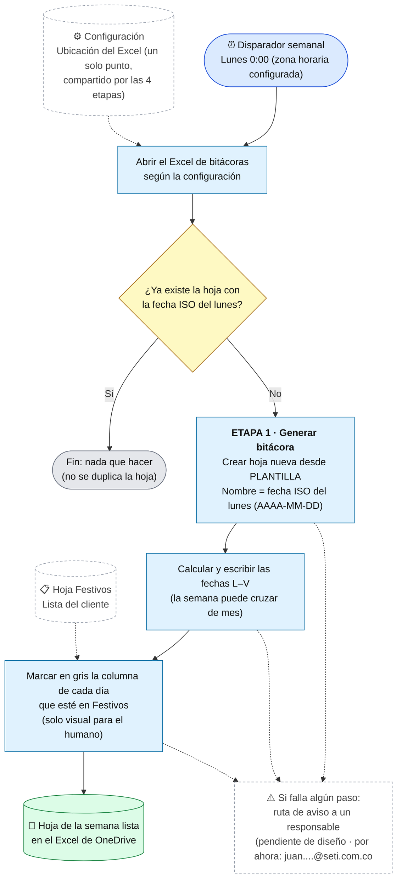

# Flujo Etapa 1 · Generar bitácora

> v0.1 · Detalle de la Etapa 1 ·
> Parte del flujo general v0.4 (en actualización). Esta etapa corre una vez por semana; las etapas 2, 3 y 4 son diarias y están fuera de este documento.

## Lectura rápida

| Elemento | Detalle |
|---|---|
| Disparador | Lunes 0:00, con la zona horaria configurada explícitamente (los festivos son de México) |
| Entrada | Hojas `PLANTILLA` y `Festivos` del Excel de bitácoras. Siempre se parte de `PLANTILLA`; la hoja de la semana anterior **no** es entrada |
| Qué hace | 1) Verifica si la hoja de la semana ya existe. 2) Si no existe, la crea desde `PLANTILLA`. 3) Escribe las fechas de lunes a viernes. 4) Marca en gris los festivos |
| Salida | Una hoja nueva por semana, con nombre = fecha ISO del lunes (10 caracteres, cabe en el límite de 31 de Excel) |
| Idempotencia | Si la hoja ya existe, no hace nada ni duplica (la Etapa 1 se puede repetir sin riesgo) |

## Decisiones aplicadas a esta etapa

1. **Una hoja nueva por semana**, no bloques apilados en una sola hoja. Porqué: las celdas quedan en direcciones fijas y la Etapa 3 no tiene que buscar el bloque de la semana entre miles de filas. Se descartó el formato apilado que se usa hoy a mano.
2. **Siempre desde `PLANTILLA`.** Porqué: se parte limpio, sin arrastrar colores ni valores de la semana anterior.
3. **Verificar que la hoja exista sin duplicar.** Porqué: el margen del lunes es corto (hoja a las 0:00 y primer correo hacia la 1:30). La Etapa 3 también verifica que la hoja exista antes de escribir.
4. **Festivos: lista entregada por el cliente**, hoy dentro del mismo Excel (hoja `Festivos`). La automatización decide con la lista, no con el color.
5. **El gris es solo visual** para quien lee la bitácora (se envía al cliente en otro correo, fuera de este alcance). No interviene en ninguna decisión del flujo.
6. **Archivo Excel configurable.** La ubicación del archivo vive en un solo punto de configuración que leen las 4 etapas. El archivo nuevo debe respetar la misma estructura (hojas `PLANTILLA`, `Festivos`, tabla de control y sus nombres).

## Fuera de esta etapa: guarda de festivos

La guarda no pertenece a la Etapa 1. Va al inicio de las etapas 2, 3 y 4, en sus dos puertas de entrada: la llegada de un correo RPA/LOG y el corte de las 8:30. Consulta la lista `Festivos` con la fecha de hoy; si es festivo, la automatización finaliza ahí. Los RPA sí pueden enviar correo en festivo (se descartan en la guarda); ninguno llega sábado ni domingo, así que la guarda solo pregunta por festivos.

