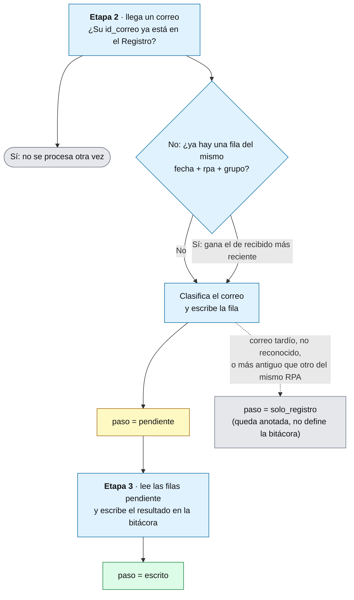

# Hoja Registro · Punto de control de la automatización

> v0.2 · Explica para qué sirve la hoja `Registro` y cómo la usan las etapas. Parte del diseño de la automatización de la bitácora RPA.

## Para qué sirve

La automatización tiene varias etapas que trabajan una después de otra. La Etapa 2 lee y clasifica los correos; la Etapa 3 escribe el resultado en la bitácora; la Etapa 4 arma el consolidado de errores. La hoja `Registro` es el **punto de control entre ellas**: una fila por cada correo procesado, con una marca (`paso`) que dice en qué punto va esa fila. Con esa marca, cada etapa sabe qué le toca hacer sin adivinar.

Conviene no confundirla con otras dos cosas:

| Cosa | Qué es | Para quién |
|---|---|---|
| **Bitácora** | La hoja semanal con una fila por RPA y los colores | El cliente |
| **Correo LOG** | El correo que manda un RPA cuando falla (solo 3 RPA lo tienen) | La operación |
| **Registro** | El cuaderno interno: qué correo llegó, cómo se clasificó y en qué paso va | Solo la automatización |

Tamaño esperado: unas 20 filas por día hábil (17 correos esperados más hasta 3 LOG), unas 5.000 al año.

## Convención de nombres

Los nombres de las columnas, y también los valores que toman, van en **minúsculas, sin espacios ni tildes y con guion bajo** (`id_correo`, `cod_error`, `solo_registro`). Así la hoja puede pasar a una base de datos sin renombrar nada.

## Cómo se usa

1. **Llega un correo.** La Etapa 2 busca su `id_correo` en el Registro. Si ya está, no lo vuelve a procesar. Esto cubre reintentos y relecturas de la carpeta.
2. **Se clasifica.** La Etapa 2 escribe una fila nueva con el RPA, el grupo, el estado y `paso = pendiente`.
3. **Se escribe en la bitácora.** La Etapa 3 busca las filas en `pendiente`, escribe el resultado en la celda que corresponde (color y `cod_error`) y cambia el `paso` a `escrito`.
4. **Si algo falla en medio**, la fila queda en `pendiente`. No se pierde nada y se puede reintentar, por ejemplo desde el corte de las 8:30.
5. **El consolidado** lo arma la Etapa 4 leyendo del Registro las filas del día con `estado = error` o `sin_llegar`, con su `cod_error` y el texto de `error`.

## Columnas

| Columna | Qué guarda | ¿Para qué sirve? |
|---|---|---|
| `fecha` | Día de la bitácora al que pertenece la fila (hora Colombia) | Filtrar "las filas de hoy" y ubicar la columna del día en la bitácora |
| `id_correo` | Identificador único del correo | Evita procesarlo dos veces. Vacío en las filas del corte de las 8:30, porque ahí no hay correo; esas se identifican por `fecha` + `rpa` |
| `recibido` | Fecha y hora de recepción (hora Colombia) | Decide cuál correo gana cuando llegan dos del mismo RPA, marca los correos tardíos y permite comparar la hora real con la `Hora aprox` del catálogo para afinar las horas |
| `rpa` | Nombre del RPA según el catálogo | Saber en qué fila de la bitácora va |
| `grupo` | `inicio`, `finalizacion` o `log` | Saber cuál de las filas del RPA en la bitácora se pinta. La variación de precios es una `finalizacion` |
| `estado` | `inicio_recibido`, `exito`, `error`, `log_esperado`, `log_recibido` o `sin_llegar` | El resultado de clasificar el correo; define el color y permite saber si ya están las 17 filas esperadas |
| `cod_error` | Código de incidente, 0 a 18 | Es lo que la Etapa 3 escribe junto a la celda roja y lo que lista el consolidado. El 0 solo lo asigna el corte de las 8:30 |
| `error` | Texto del error copiado tal cual de la fila Motivo del correo | El consolidado lo copia en todos los errores, reconocidos o no |
| `observacion` | Nota opcional: `no_reconocido`, `revisar_formato`, `tardio` o `corte_0830` | Deja rastro de casos especiales sin cambiar el flujo |
| **`paso`** | `pendiente`, `escrito` o `solo_registro` | **Es la columna clave:** le dice a cada etapa qué hacer |

El valor `error` de la columna `estado` y la columna `error` son cosas distintas: la primera es el resultado del correo; la segunda, el texto que trae.

## Qué no guarda

- **La hora en que se escribió en la bitácora.** El `paso = escrito` ya dice que se escribió.

## Valores de `paso`

| Valor | Cuándo | Quién lo pone |
|---|---|---|
| `pendiente` | El correo ya se clasificó y falta escribirlo en la bitácora | Etapa 2 |
| `escrito` | El resultado ya está en la bitácora | Etapa 3 |
| `solo_registro` | La fila queda anotada pero no define lo que muestra la bitácora: correo tardío (después de las 8:30), correo no reconocido, o finalización reemplazada por otra más reciente del mismo RPA | Etapa 2 |

## Reglas

- **`id_correo` y "gana el último" miran cosas distintas.** El `id_correo` identifica **un mismo correo**: si el flujo lo ve dos veces, lo salta. "Gana el último" aplica a **dos correos distintos** del mismo RPA el mismo día: la llave es `fecha` + `rpa` + `grupo`, y gana el de `recibido` más reciente. La fila del correo que pierde pasa a `solo_registro`.
- **Una fila por correo.** El mismo `id_correo` no aparece dos veces.
- **Filas del corte de las 8:30.** Lo que sigue sin estado a las 8:30 se anota con `estado = sin_llegar`, `cod_error = 0`, `paso = pendiente`, `observacion = corte_0830` y sin `id_correo`.
- **Correos tardíos.** Un correo de finalización posterior a las 8:30 queda como `solo_registro` con `observacion = tardio`, sin tocar la celda roja ni el consolidado ya enviado.
- **Festivos.** En un día festivo no se escribe nada en el Registro: la automatización termina antes.
