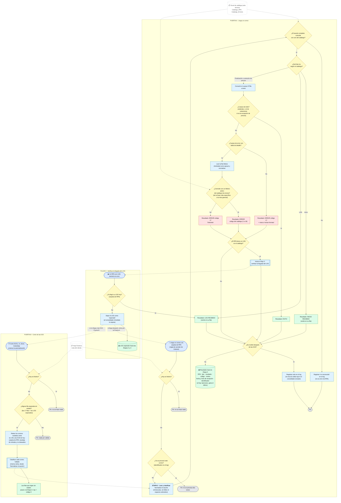

# Flujo Etapa 2 · Leer y clasificar correos

> v0.1 · Detalle de la Etapa 2 ·
> Parte del flujo general v0.4 (en actualización). Esta etapa tiene dos puertas de entrada: la llegada de un correo y el corte de las 8:30. Las etapas 3 y 4 solo se mencionan donde tocan a esta (entrada y salida).

## Lectura rápida

| Elemento | Detalle |
|---|---|
| Disparadores | 1) Llega un correo a la carpeta de RPA. 2) Corte de las 8:30 a. m., hora Colombia (arranca la automatización por hora). 3) Flujo 2, que arranca cuando un RPA con LOG termina en error |
| Entrada | El correo (asunto y cuerpo), la hoja `Festivos` y el Excel de catálogo (`Catalogo_RPA` y `Catalogo_Errores`), que solo se lee |
| Qué hace | Descarta festivos y duplicados, reconoce el correo por su asunto completo, lo clasifica por tipo (inicio, finalización, variación de precios o LOG) y, si es de finalización, decide éxito o error y su código |
| Salida | Un resultado por correo hacia la Etapa 3: RPA, tipo, resultado, código, motivo, fecha y hora de recepción e identificador. No escribe en la bitácora |
| Filas esperadas | 17 filas (8 de inicio, 8 de finalización y la variación de precios) y 3 de LOG, que solo se esperan si su RPA falló |

## Decisiones aplicadas a esta etapa

1. **El asunto completo identifica el correo.** Los asuntos son fijos y se comparan enteros, ya normalizados, contra el catálogo; el tipo sale del catálogo. Porqué: algunos nombres están contenidos en otros (un LOG lleva el nombre de su RPA), y con la coincidencia completa no se confunden.
2. **Tres grupos de correo: inicio, finalización y LOG.** El correo de inicio siempre debe llegar y se marca en verde en su fila; su único error posible es que no llegue (código 0). Porqué: tiene su propia fila en la bitácora y no define el estado final del RPA.
3. **El error se lee siempre de la fila Motivo.** Se compara normalizado, con la frase completa y de la más específica a la más general. Si nada coincide, es código 17 (Detenido); un cuerpo que no se reconoce es código 17 con marca "revisar formato", nunca éxito. Porqué: un falso éxito esconde un problema; un falso error solo cuesta una revisión.
4. **Variación de precios:** si llega, es éxito; si no llega, es 0. No tiene otro error posible.
5. **LOG: flujo 2 aparte.** Cuando un RPA con LOG termina en error, el flujo 2 revisa si su LOG ya llegó. Si no, lo deja como esperado y el consolidado inmediato lo espera. Si llega después, entra por la puerta A y queda en verde; si a las 8:30 no llegó, queda en rojo con 0. Porqué: el LOG solo llega si el RPA anterior falla, así que su ausencia solo es error en ese caso.
6. **El corte de las 8:30 es un disparador por hora.** Porqué: "No llegó" es la ausencia de un evento, y un flujo que solo se dispara al llegar un correo no corre cuando no llega ninguno.
7. **Revisión de las 8:30 solo si hay filas sin estado.** Relee, de la 1:00 a las 8:30 de hoy, la carpeta de RPA, la bandeja de entrada y los no deseados. Porqué: evita un falso "No llegó" cuando la regla de Outlook falla y el correo queda fuera de la carpeta. Lo que siga sin estado pasa a la Etapa 3 con rojo y código 0.
8. **Correo posterior a las 8:30:** se registra solo en el log, sin tocar la celda roja ni el consolidado ya enviado. Si un RPA reenvía su finalización el mismo día, gana el último y el anterior queda en el log.
9. **Guarda de festivos en las dos puertas** (llegada de correo y corte de las 8:30). Si es festivo, la ejecución termina ahí aunque llegue un correo.
10. **No procesar dos veces:** se guarda el identificador de cada correo en el log. Porqué: cubre reintentos y reprocesos.
11. **El catálogo es un archivo aparte, solo de lectura.** El Excel que genera las bitácoras nuevas es otro. Porqué: lo único que cambia con el tiempo (asuntos y errores) queda en un lugar editable sin tocar el flujo.

## Fuera de esta etapa

Pintar la bitácora, marcar el código 0 y escribir los colores es de la Etapa 3. El consolidado y el correo del ticket son de la Etapa 4, que espera a que las filas esperadas y los LOG esperados tengan estado.
