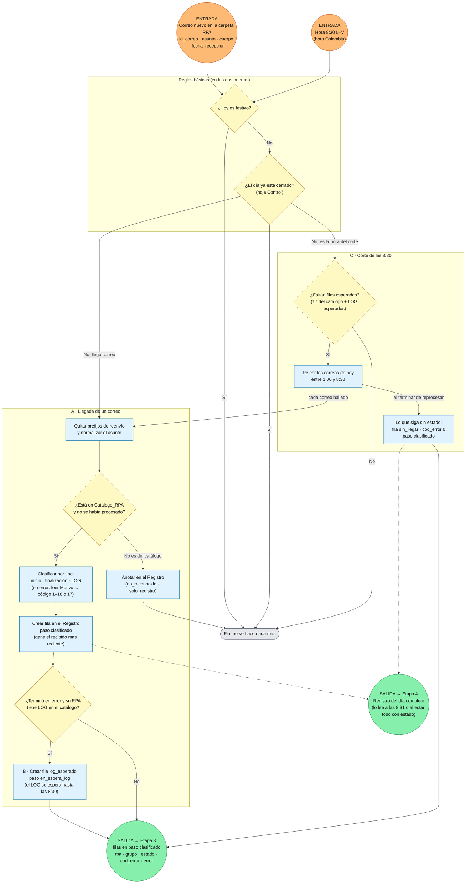

# Flujo Etapa 2 · General · Leer y clasificar correos

> v0.1 · Une los flujos A (llegada de correo), B (verificación del LOG) y C (corte de las 8:30) en una sola vista. Es más general: el detalle de cada parte está en su flujo.
> 🟠 entrada · 🟢 salida (con la variable que viaja)

## Lectura rápida

| Conexión | Variable | Con quién |
|---|---|---|
| 🟠 Entrada | id_correo, asunto, cuerpo, fecha_recepción | Carpeta de RPA en Outlook (puerta de llegada de correo) |
| 🟠 Entrada | Hora 8:30 L–V | Disparador por hora (puerta del corte) |
| 🟢 Salida | rpa, grupo, estado, cod_error, error (filas en paso clasificado) | Etapa 3 |
| 🟢 Salida | Registro del día con todos los estados | Etapa 4 |

## Cómo se lee

1. **Las dos puertas** (correo nuevo y 8:30) pasan por las mismas dos reglas: si es festivo no se hace nada, y si el día ya está cerrado tampoco.
2. **Cada correo** se limpia, se reconoce con el catálogo, se clasifica y queda como una fila nueva en el Registro. Los RPA que terminan en error y tienen LOG dejan además una fila de LOG esperado.
3. **El corte de las 8:30** revisa si falta algún estado esperado, relee los correos de la madrugada (por si la regla de Outlook falló) y marca `sin_llegar` con código 0 lo que siga sin aparecer.
4. **Las Etapas 3 y 4** dependen de esta etapa, no una de la otra: la 3 refleja las filas `clasificado` en la bitácora y la 4 consolida con lo que hay en el Registro.

## Reglas básicas de arranque

1. Si hoy es festivo, la ejecución termina sin hacer nada.
2. Si el día ya está cerrado en la hoja Control, la ejecución termina sin hacer nada.
3. Un correo no se procesa dos veces (id_correo en el Registro).
