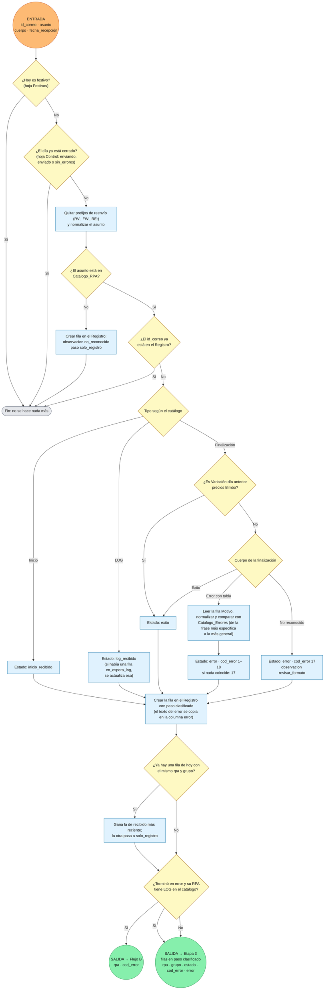

# Flujo Etapa 2 · A · Llegada de correo

> v0.2 · Puerta de llegada de correo RPA/LOG. 🟠 entrada · 🟢 salida (con la variable que viaja)

## Lectura rápida

| Conexión | Variable | Con quién |
|---|---|---|
| 🟠 Entrada | id_correo, asunto, cuerpo, fecha_recepción | Correo nuevo en la carpeta de RPA (o correo hallado por el Flujo C) |
| 🟢 Salida | rpa, grupo, estado, cod_error, error | Etapa 3 |
| 🟢 Salida | rpa, cod_error | Flujo B (verificación del LOG) |

## Reglas básicas de arranque

1. Si hoy es festivo, la ejecución termina sin hacer nada.
2. Si el día ya está cerrado en la hoja Control, la ejecución termina sin hacer nada.
3. Un correo no se procesa dos veces (id_correo en el Registro).
