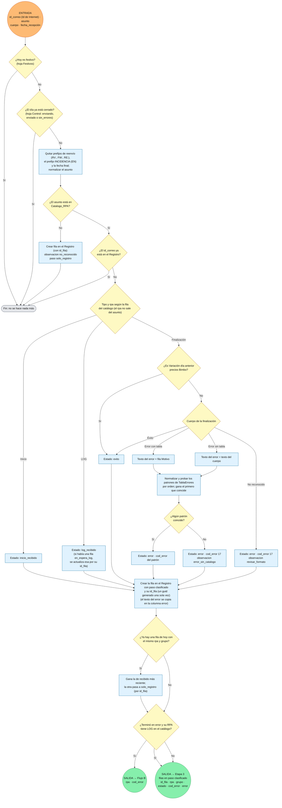

# Flujo Etapa 2 · A · Llegada de correo

> v1.0 · Puerta de llegada de correo RPA/LOG. 🟠 entrada · 🟢 salida (con la variable que viaja)

## Lectura rápida

| Conexión | Variable | Con quién |
|---|---|---|
| 🟠 Entrada | id_correo (Id de Internet), asunto, cuerpo, fecha_recepción | Correo nuevo en la carpeta de RPA (o correo hallado por el Flujo C) |
| 🟢 Salida | id_fila, rpa, grupo, estado, cod_error, error | Etapa 3 |
| 🟢 Salida | rpa, cod_error | Flujo B (verificación del LOG) |

## Reglas básicas de arranque

1. Si hoy es festivo, la ejecución termina sin hacer nada.
2. Si el día ya está cerrado en la hoja Control, la ejecución termina sin hacer nada.
3. Un correo no se procesa dos veces (el id_correo, que es el Id de Internet del correo, ya está en el Registro).

## Cómo se lee el error

1. El asunto se limpia (prefijos de reenvío, "INCIDENCIA (EN)" y fecha final) y se busca completo en el catálogo; de esa fila salen el tipo y el `rpa`.
2. En una finalización con error, el texto sale de la fila Motivo (si el correo trae tabla) o del cuerpo (si no la trae).
3. Se prueban los patrones de la tabla de errores en orden, de lo más específico a lo más general; gana el primero que coincide.
4. Si ningún patrón coincide, el código es 17 con la marca `error_sin_catalogo`. El texto del error nunca se descarta: se copia tal cual a la columna `error`.
5. Un cuerpo que no es éxito ni error identificable queda en 17 con la marca `revisar_formato`; nunca se toma como éxito.

## Sobre las filas del Registro

- Toda fila nueva lleva un `id_fila` (un guid) que se genera una sola vez, al crearla, y no cambia nunca. Es la llave con la que se actualiza la fila.
- El `id_correo` no es una llave de actualización: solo sirve para no procesar dos veces el mismo correo.
