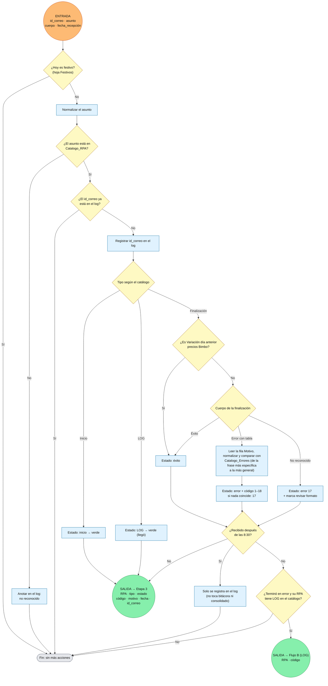

# Flujo Etapa 2 · A · Llegada de correo

> v0.1 · Puerta de llegada de correo RPA/LOG. 🟠 entrada · 🟢 salida (con la variable que viaja)

## Lectura rápida

| Conexión | Variable | Con quién |
|---|---|---|
| 🟠 Entrada | id_correo, asunto, cuerpo, fecha_recepción | Correo nuevo en la carpeta de RPA |
| 🟢 Salida | RPA, tipo, estado, código, motivo, fecha, id_correo | Etapa 3 |
| 🟢 Salida | RPA, código | Flujo B (verificación del LOG) |