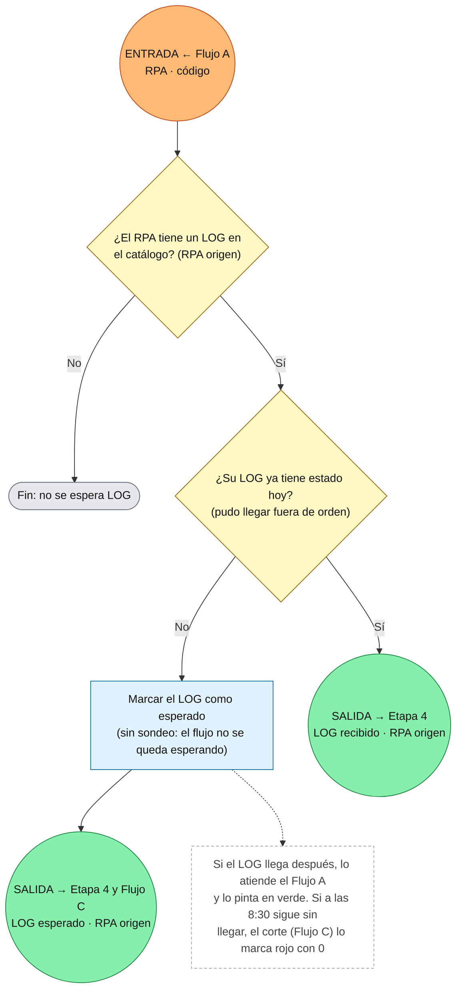

# Flujo Etapa 2 · B · Verificación de llegada del LOG

> v0.1 · Corre cuando un RPA con LOG asociado termina en error. 🟠 entrada · 🟢 salida

## Lectura rápida

| Conexión | Variable | Con quién |
|---|---|---|
| 🟠 Entrada | RPA, código | Flujo A |
| 🟢 Salida | LOG recibido · RPA origen | Etapa 4 |
| 🟢 Salida | LOG esperado · RPA origen | Etapa 4 y Flujo C |