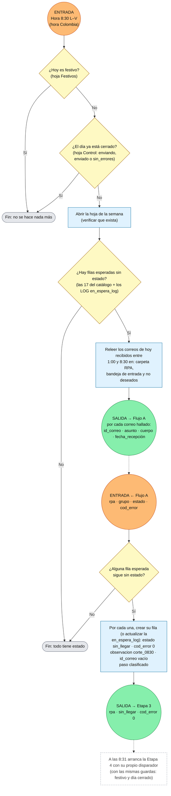

# Flujo Etapa 2 · C · Corte de las 8:30

> v0.2 · Disparador por hora, L–V 8:30 (hora Colombia). 🟠 entrada · 🟢 salida

## Lectura rápida

| Conexión | Variable | Con quién |
|---|---|---|
| 🟠 Entrada | Hora 8:30 L–V | Disparador por hora |
| 🟢 Salida | id_correo, asunto, cuerpo, fecha_recepción (uno por correo hallado) | Flujo A |
| 🟠 Entrada | rpa, grupo, estado, cod_error | Flujo A |
| 🟢 Salida | rpa, sin_llegar, cod_error 0 | Etapa 3 |

## Reglas básicas de arranque

1. Si hoy es festivo, la ejecución termina sin hacer nada.
2. Si el día ya está cerrado en la hoja Control, la ejecución termina sin hacer nada.
3. La Etapa 4 arranca a las 8:31 con su propio disparador, un minuto después del corte.
