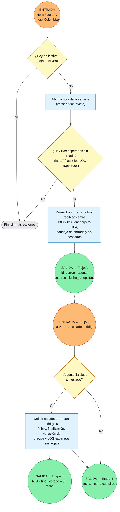

# Flujo Etapa 2 · C · Corte de las 8:30

> v0.1 · Disparador por hora, L–V 8:30 (hora Colombia). 🟠 entrada · 🟢 salida

## Lectura rápida

| Conexión | Variable | Con quién |
|---|---|---|
| 🟠 Entrada | Hora 8:30 L–V | Disparador por hora |
| 🟢 Salida | id_correo, asunto, cuerpo, fecha_recepción | Flujo A (cada correo recuperado) |
| 🟠 Entrada | RPA, tipo, estado, código | Flujo A (resultado) |
| 🟢 Salida | RPA, tipo, estado = 0, fecha | Etapa 3 |
| 🟢 Salida | fecha, corte cumplido | Etapa 4 |