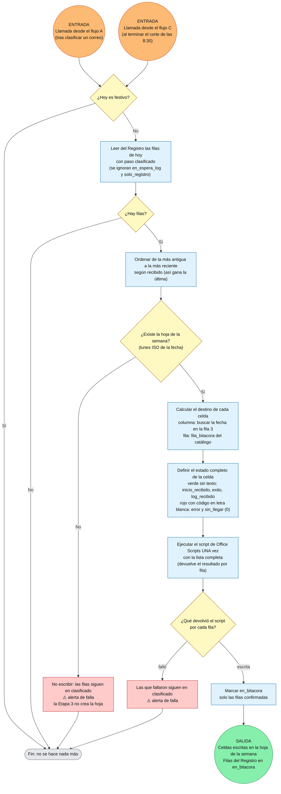

# Flujo Etapa 3 · Actualizar bitácora

> v0.1 · Detalle de la Etapa 3 · Refleja en la hoja de la semana lo que la Etapa 2 dejó clasificado en el Registro.
> 🟠 entrada · 🟢 salida (con la variable que viaja)

## Lectura rápida

| Elemento | Detalle |
|---|---|
| Entradas | La llama el flujo A después de clasificar cada correo y el flujo C al terminar el corte de las 8:30. Cada llamada barre **todas** las filas `clasificado` del día, sin importar quién la llamó |
| Guarda | Solo la de festivo. No lleva la de día cerrado |
| Qué lee | Registro: filas de hoy con `paso = clasificado` (ignora `en_espera_log` y `solo_registro`) |
| Destino de cada celda | Hoja = lunes ISO de la fecha · columna = la del día (la fecha se busca en la fila 3) · fila = `fila_bitacora` del catálogo |
| Qué escribe | Un script fijo de Office Scripts escribe valor y color. Verde `#92D050` sin texto (inicio recibido, éxito, LOG recibido) · rojo `#FF0000` con el código en letra blanca (error y 0). La fila del LOG pasa de gris a verde cuando llega |
| Salida | Celdas de estado escritas y filas del Registro en `en_bitacora`. No alimenta a la Etapa 4, que lee el Registro |

## Decisiones aplicadas a esta etapa

1. **Solo guarda de festivo.** Con la consolidación inmediata el día puede cerrarse hacia las 7:50; con la guarda de día cerrado la Etapa 3 no escribiría nada ese día. La guarda existe para no validar correos nuevos, y esta etapa solo refleja lo ya clasificado.
2. **Llamada desde A y C.** Quienes usan la bitácora están acostumbrados a verla llenarse para saber cómo va el proceso.
3. **Un script fijo escribe valor y color; sin formato condicional.** El conector de Excel no escribe en celdas sueltas, así que el script se necesita de todas formas. El formato condicional chocaría con los códigos de error 1 a 18.
4. **Estado completo de la celda en cada escritura.** Un éxito posterior a un error borra el código y cambia a verde.
5. **Una sola ejecución del script con la lista completa**, para reducir bloqueos del archivo. La concurrencia del flujo se limita a 1.
6. **Marcar `en_bitacora` solo después de escribir.** Si el flujo cae a la mitad, las filas siguen en `clasificado` y la próxima llamada reescribe lo mismo sin daño.
7. **No crea la hoja de la semana.** Hacerlo taparía una falla de la Etapa 1; si no existe, no escribe y avisa.
8. **La fila sale de la columna `fila_bitacora` de `TablaRPA`** (catálogo). `PLANTILLA` es general: la ubicación no cambia entre hojas, solo cambia la hoja.
9. **No toca nada fuera de las celdas de estado** (columna D, leyenda de incidentes y texto de situación general quedan intactos).
