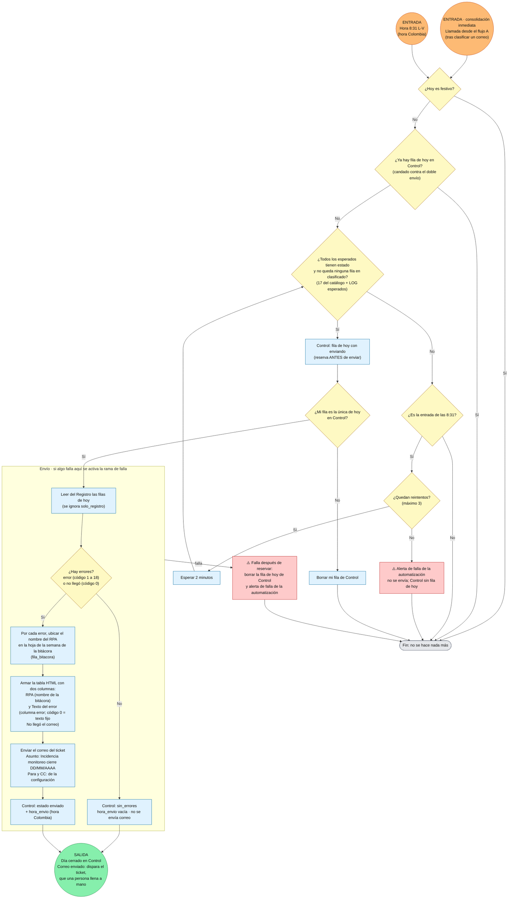

# Flujo Etapa 4 · Consolidado de errores

> v1.0 · Detalle de la Etapa 4 · Lee el Registro del día y envía un único consolidado de errores, solo cuando hay errores; cierra el día en la hoja `Control`.
> 🟠 entrada · 🟢 salida (con la variable que viaja)

## Lectura rápida

| Elemento | Detalle |
|---|---|
| Entradas | Dos formas de arrancar: consolidación inmediata (llamada desde el flujo A) y un disparador propio a las **8:31**, un minuto después del corte |
| Guardas | Festivo en cada entrada. Antes de enviar se revisa `Control` como candado contra el doble envío (no es la guarda de día cerrado de las demás etapas) |
| Condición para consolidar | Todos los esperados tienen estado (17 filas del catálogo: 8 inicio, 8 finalización y 1 variación de precios, más los LOG esperados) y no queda ninguna fila en `clasificado` |
| Si no se cumple | En la consolidación inmediata termina sin hacer nada. A las 8:31 espera 2 minutos y reintenta hasta 3 veces (~8:37); si sigue sin cumplirse, alerta y no envía |
| Qué entra al correo | Filas del día con error (código 1 a 18) o que no llegaron (código 0, incluidos los LOG esperados que no llegaron) |
| Tabla del correo | Dos columnas: `RPA` (nombre de la fila en la bitácora) y `Texto del error` (columna `error`; en código 0, el texto fijo `No llegó el correo`) |
| Día sin errores | `Control` queda en `sin_errores`, sin `hora_envio` y sin correo; el día queda cerrado |
| Falla después de reservar | Se borra la fila de hoy de `Control` y salta la alerta; el siguiente disparador puede reintentar |
| Salida | Fila del día en `Control` (`enviado` con `hora_envio`, o `sin_errores`) y, si hubo errores, el correo que dispara el ticket |
| `ticket` | Lo llena una persona a mano; fuera del alcance de la automatización |

## Decisiones aplicadas a esta etapa

1. **Un solo consolidado por día hábil**, no correos de corrección. Es una foto estable del día y el punto final de la bitácora: no se modifica después de enviarlo.
2. **Consolidación inmediata + disparador de las 8:31.** La inmediata detecta y comunica errores más temprano; la de las 8:31 cubre lo que no llegó. Los esperados se comparan por estado de cada fila, no por "llegó el RPA 17", porque los correos pueden llegar fuera de orden.
3. **No se envía con filas pendientes.** Hace falta que todos los esperados tengan estado y que no quede ninguna fila en `clasificado` (no está todavía en la bitácora). A las 8:31 se reintenta tres veces antes de alertar, para cubrir un corte lento.
4. **Lee el Registro.** Depende de la Etapa 2 y no de la Etapa 3. De la bitácora solo toma el nombre de cada fila con error.
5. **Candado en `Control`.** Si la consolidación inmediata ya envió (o está enviando), el disparador de las 8:31 lo ve y se detiene. Sin él saldrían dos correos.
6. **Reservar antes de enviar.** `enviando` → enviar → `enviado`. Después de reservar se comprueba que la fila propia sea la única de hoy, porque el conector de Excel no es atómico. La concurrencia de cada disparador se limita a 1.
7. **Si algo falla después de reservar**, se borra la fila de hoy de `Control` y se alerta; una fila `enviando` atascada cerraría el día sin correo.
8. **El texto del error se copia tal como viene en el correo**, en todos los errores. Lo que no llegó (código 0) lleva un texto fijo, definido en la configuración.
9. **El nombre del RPA sale de la bitácora**, no del Registro, para distinguir un cierre de su LOG.
10. **Correo solo cuando hay errores.** Un día sin errores se cierra en `Control` sin correo.
11. **Un inicio que no llegó se informa con código 0**, aunque el RPA haya terminado bien. El equipo correspondiente decide cómo lo maneja.
12. **Solo esta etapa escribe en `Control`** (estado y hora). Las demás solo leen.
13. **Si falla la automatización, se avisa** (alerta de falla); no se marcan falsos errores de RPA.
