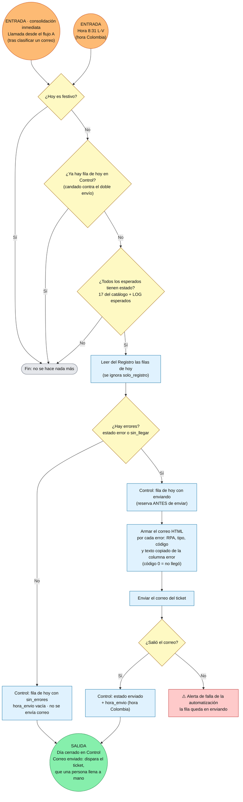

# Flujo Etapa 4 · Consolidado de errores

> v0.1 · Detalle de la Etapa 4 · Lee el Registro del día y envía un único consolidado de errores; cierra el día en la hoja `Control`.
> 🟠 entrada · 🟢 salida (con la variable que viaja)

## Lectura rápida

| Elemento | Detalle |
|---|---|
| Entradas | Dos formas de arrancar: apenas todos los esperados tienen estado (consolidación inmediata) y un disparador propio a las **8:31**, un minuto después del corte |
| Guardas | Festivo en cada entrada. Antes de enviar se revisa `Control` como candado contra el doble envío (no es la guarda de día cerrado de las demás etapas) |
| Condición para consolidar | Todos los esperados tienen estado: 17 filas del catálogo (8 inicio, 8 finalización, 1 variación de precios) más los LOG esperados |
| Qué consolida | Filas del día con estado `error` o `sin_llegar`. Cada una lleva RPA, tipo, código y el texto del error copiado de la columna `error` (código 0 = no llegó) |
| Día sin errores | `Control` queda en `sin_errores`, sin `hora_envio` y sin correo; el día queda cerrado |
| Salida | Fila del día en `Control` (`enviado` con `hora_envio`, o `sin_errores`) y, si hubo errores, el correo que dispara el ticket |
| `ticket` | Lo llena una persona a mano; fuera del alcance de la automatización |

## Decisiones aplicadas a esta etapa

1. **Un solo consolidado por día hábil**, no correos de corrección. Es una foto estable del día.
2. **Consolidación inmediata + disparador de las 8:31.** La inmediata detecta y comunica errores más temprano; la de las 8:31 cubre lo que no llegó. Los esperados se comparan por estado de cada fila, no por "llegó el RPA 17", porque los correos pueden llegar fuera de orden.
3. **Lee el Registro, no la bitácora.** Depende de la Etapa 2 y no de la Etapa 3; el orden entre 3 y 4 no importa.
4. **Candado en `Control`.** Si la consolidación inmediata ya envió (o está enviando), el disparador de las 8:31 lo ve y se detiene. Sin él saldrían dos correos.
5. **Reservar antes de enviar.** `enviando` → enviar → `enviado`, para que dos ejecuciones no manden el mismo consolidado. La concurrencia de cada disparador se limita a 1.
6. **El texto del error se copia tal como viene en el correo**, en todos los errores. El texto ya se lee para clasificar; copiarlo evita reglas adicionales.
7. **Un inicio que no llegó se informa con código 0**, aunque el RPA haya terminado bien. El equipo correspondiente decide cómo lo maneja.
8. **Solo esta etapa escribe en `Control`** (estado y hora). Las demás solo leen.
9. **Si falla la automatización, se avisa** (alerta de falla); no se marcan falsos errores de RPA.
