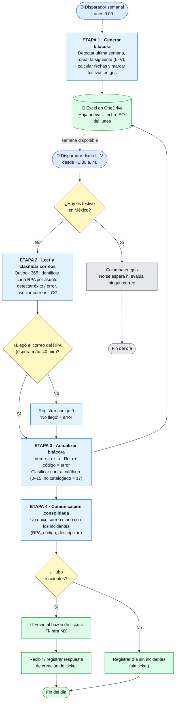

# Flujo general – Automatización bitácora RPA (Sura MX)

> Versión 0.1 · Borrador para validar · Herramienta base: **Power Automate (nube)**. Python queda *en consideración* (ver memoria de decisiones).

## Diagrama general (4 etapas)

## Lectura rápida

| Etapa | Disparador | Entrada | Salida |
|---|---|---|---|
| 1 · Generar bitácora | Lunes 0:00 | Última hoja de la bitácora + hoja `Festivos` | Hoja nueva de la semana (festivos en gris) |
| 2 · Leer y clasificar | Diario L–V | Correos de Outlook 365 | Estado por RPA (éxito / error / no llegó) |
| 3 · Actualizar bitácora | Fin de cada lectura | Estado por RPA + catálogo de incidentes | Celdas con color y código |
| 4 · Consolidado | Tras el último RPA (+ espera) | Incidentes del día | Correo de ticket + respuesta registrada |

## Puntos abiertos que afectan este flujo

1. **Hora de corte del consolidado:** el doc de definición dice 7:32 + 40 min de espera; el contexto inicial dice que el último RPA llega a las 7:46. Falta confirmar la hora real.
2. **Office Scripts en el tenant:** el script actual de la Etapa 1 lo requiere; si no está habilitado, la Etapa 1 hay que resolverla solo con acciones nativas de Excel.
3. **Cuenta de ejecución:** hoy se haría con la cuenta personal; falta saber cuál es válida según parámetros de SETI.
4. **Falla de la propia automatización (EX-06):** el diagrama aún no incluye la ruta de aviso a un responsable; se propone modelarla en el detalle por etapa.
