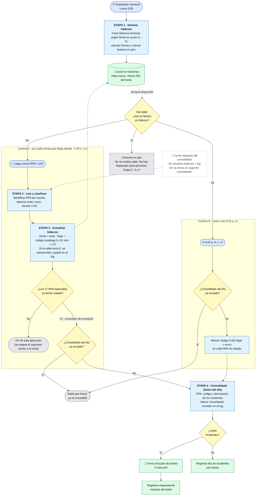

# Flujo general - automatización

> v0.4 · Automatización en 4 etapas. (En actualización)

>Proceso estandarizado por horas. 
> 8:00 am Consolidado inmediato si los 17 RPA sí ya tienen estado definido

> 8:30 am. Sí no se ha enviado consolidado y hay RPA sin estado, se coloca en 0 'No llegó" y se añade al consolidado de errores

## Lectura rápida

| Etapa | Disparador | Entrada | Salida |
|---|---|---|---|
| 1 · Generar bitácora | Lunes 0:00 | Última hoja de la bitácora + hojas `PLANTILLA` y `Festivos` | Hoja nueva de la semana (festivos en gris) |
| 2 · Leer y clasificar | Cada correo RPA/LOG que llega (L–V, desde ~1:30 a. m.; no se evalúa en festivo) | Correos de Outlook 365 | Estado por RPA (éxito / error + código) |
| 3 · Actualizar bitácora | Tras clasificar cada correo; y a las 8:25 a. m. para los RPA sin estado | Estado por RPA + catálogo de incidentes | Celdas en verde, o rojo + código; rojo + código 0 ("No llegó") a las 8:25 |
| 4 · Consolidado | Lo que ocurra primero: los 17 RPA ya tienen estado (consolida de inmediato) o corte de las 8:25 a. m. (hora Colombia) | Incidentes del día + tabla de control | Un único correo de ticket + respuesta registrada; marca "consolidado enviado" en la tabla de control |

## Puntos abiertos que afectan este flujo

1. **Correos LOG con consolidación inmediata (P-01):** ¿se consolida sin esperar el LOG o se espera si hay error en los 3 RPA que lo envían?
2. **Correo posterior a las 8:25 (P-02):** con la revisión única, la celda queda en rojo con 0; falta definir si el correo tardío se ignora, va solo al log o se anota aparte.
3. **Consolidación inmediata vs. revisión única (P-06):** confirmar si se mantiene la comprobación de "17 con estado" tras cada correo.
4. **Día sin incidentes (P-03) y RPA esperados por día (P-04):** ¿Ti-Infra espera correo diario sin errores? ¿Son los mismos 17 todos los días?
5. **Office Scripts en el tenant:** el script actual de la Etapa 1 lo requiere; si no está habilitado, se resuelve con acciones nativas de Excel.
6. **Cuenta de ejecución:** hoy se haría con la cuenta personal; falta saber cuál es válida según parámetros de SETI.
7. **Falla de la propia automatización (EX-06):** el diagrama aún no incluye la ruta de aviso a un responsable; se modelará en el detalle por etapa.
8. **Pendientes de diseño:** crear la tabla de control en el Excel y publicar el flujo general v0.4, sin la sobrescritura del 0.
