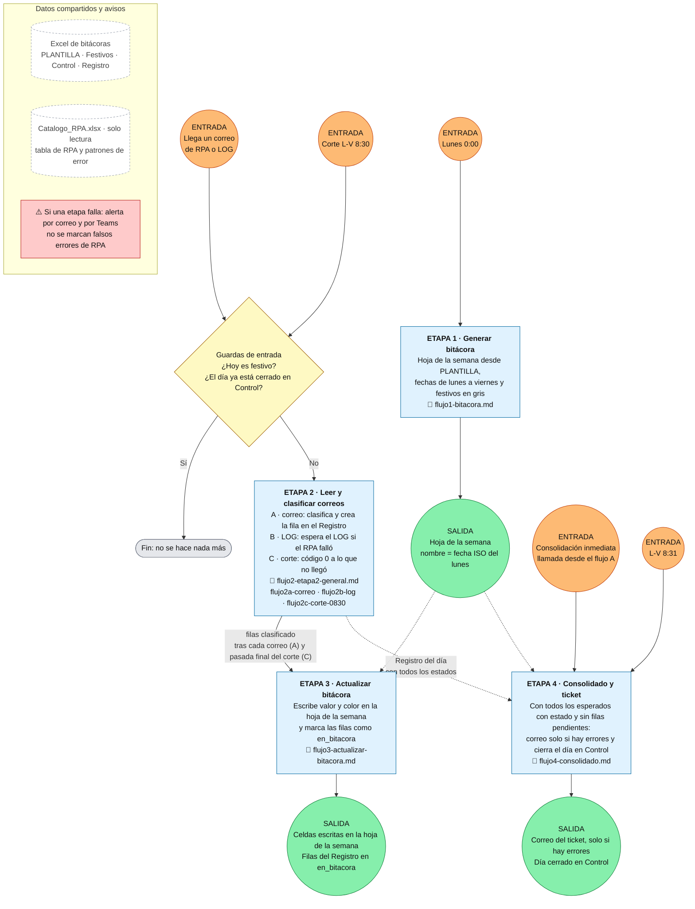

# Flujo general · Automatización de la bitácora de ejecuciones RPA

> v1.0 · Vista de todo el proyecto: las cuatro etapas y cómo se conectan. El detalle de cada una está en su propio flujo (📄).
> 🟠 entrada · 🟢 salida (con la variable que viaja)

## Un día típico (hora Colombia)

| Hora | Qué pasa |
|---|---|
| Lunes 0:00 | La Etapa 1 crea la hoja de la semana |
| Desde ~1:30 | Llegan los correos de los RPA. Por cada uno, la Etapa 2 lo clasifica y la Etapa 3 lo refleja en la bitácora |
| Hacia las ~7:50 | Si todos los esperados ya tienen estado, la Etapa 4 consolida de inmediato |
| 8:30 | Corte: la Etapa 2 marca con código 0 lo que no llegó y la Etapa 3 hace su pasada final |
| 8:31 | La Etapa 4 consolida y cierra el día. Si falta algo, espera y reintenta unos minutos antes de alertar |

## Cómo se conectan las etapas

| De → A | Qué viaja |
|---|---|
| 🟢 Etapa 1 → Etapas 3 y 4 | Hoja de la semana (nombre = fecha ISO del lunes) |
| 🟢 Etapa 2 → Etapa 3 | Filas en paso `clasificado`: `id_fila`, `rpa`, `grupo`, `estado`, `cod_error`, `error`, `recibido` |
| 🟢 Etapa 2 → Etapa 4 | Registro del día con todos los estados (la Etapa 4 lee el Registro, no la bitácora) |
| 🟢 Etapa 3 → bitácora y Registro | Valor y color de cada celda; las filas pasan a `en_bitacora` |
| 🟢 Etapa 4 → Control y correo | Estado del día (`enviando`, `enviado` o `sin_errores`) y, si hubo errores, el correo del ticket |
| 🟠 Control → Etapas 2, 3 y 4 | Las guardas leen si el día ya está cerrado |

## Reglas que valen para todo el proyecto

1. **Herramienta única:** Power Automate en la nube, con Outlook y Excel. Todos los disparadores van en hora de Colombia.
2. **Dos disparadores independientes:** el semanal (Etapa 1) y los diarios de lunes a viernes (Etapas 2 a 4).
3. **Dos reglas básicas en las puertas de entrada:** si hoy es festivo, no se hace nada; si el consolidado ya se envió, no se sigue validando. La Etapa 1 corre todos los lunes sin guardas. La Etapa 3 solo lleva la de festivo. La Etapa 4 lleva la de festivo y revisa `Control` como candado contra el doble envío.
4. **El Registro es el punto de control entre etapas:** cada etapa sabe qué le toca por la columna `paso`, y se puede reintentar sin releer los correos.
5. **El consolidado es el punto final del día:** la bitácora no se modifica después de enviarlo.
6. **Excel configurable:** la ubicación de los archivos y los destinatarios viven en un solo punto de configuración que leen las cuatro etapas.
